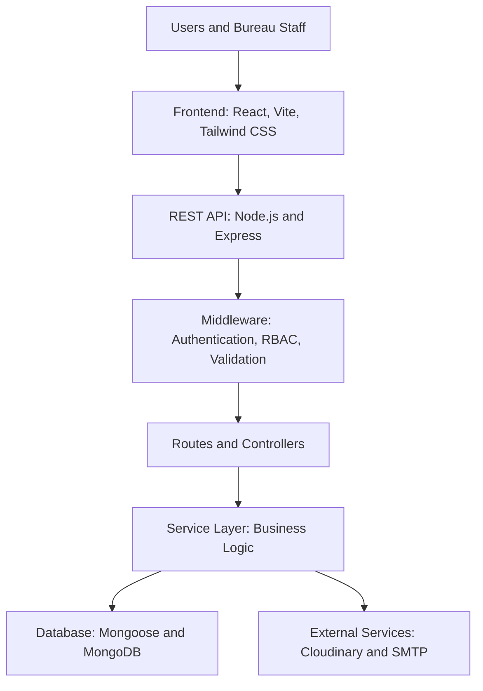

# ITSMS — Innovation and Technology Service Management System

A full-stack web platform designed to help the **Amhara National Regional State Innovation and Technology Bureau (ANRS ITB)** manage service requests, program applications, approvals, documents, team workflows, reporting, and audit records in one place.


> **Project status:** Update this badge/description to reflect the real deployment status. Do not describe the system as production-ready unless it has been deployed and validated in its intended environment.

---

## Table of Contents

- [Overview](#overview)
- [Key Features](#key-features)
- [System Architecture](#system-architecture)
- [Technology Stack](#technology-stack)
- [User Roles](#user-roles)
- [Project Structure](#project-structure)
- [Getting Started](#getting-started)
- [Environment Variables](#environment-variables)
- [Running the Application](#running-the-application)
- [API Documentation](#api-documentation)
- [Testing](#testing)
- [Security Notes](#security-notes)

---

## Overview

The **Innovation and Technology Service Management System (ITSMS)** is a web application developed for the **Amhara National Regional State Innovation and Technology Bureau (ANRS ITB)**.

The system is intended to replace fragmented, paper-based workflows with a centralized digital platform. It supports program applications, technology service requests, multi-level review and approval, document handling, staff and team coordination, reports, notifications, and activity auditing.

### Project objectives

- Digitize service and program application processes.
- Make application and service-request statuses easier to track.
- Support review and approval workflows across relevant roles.
- Centralize document and record management.
- Improve coordination between directorates, team leads, and staff.
- Provide reporting and analytics to support monitoring.
- Maintain audit records for important system actions.

## Key Features

### Authentication and access control
- JWT-based authentication.
- Email verification and password-reset workflows, where configured.
- Password hashing with `bcryptjs`.
- Role-based access control (RBAC).
- Request validation and rate limiting.

### Program application management
- Applications for internship, innovation, startup, and training programs.
- Application status tracking and review workflows.
- Supporting-document uploads through Cloudinary, when configured.
- Administrative review and routing.

### Technology service requests
- Submit and track service requests.
- Attach supporting documents.
- Assign requests or tasks to responsible staff.
- Track progress through the service workflow.

### Organization and team workflows
- Manage directorates, teams, and staff.
- Assign tasks and follow their progress.
- Support role-specific dashboards and responsibilities.

### Reports and analytics
- Submit, review, and provide feedback on reports.
- Display application, program, or team information through dashboard charts.
- Support management monitoring and reporting.

### Documents and notifications
- Upload and retrieve supporting documents.
- Send email notifications through Nodemailer, when SMTP is configured.
- Provide in-app notifications and status updates where implemented.

### QR-code attendance
- Generate QR codes for training sessions.
- Scan codes to record trainee attendance.
- Review attendance history, where enabled.

### Audit trail
- Record important system actions and approval decisions.
- Help administrators review activity and accountability.

### Responsive interface
- React-based interface designed for desktop, tablet, and mobile screens.
- Tailwind CSS styling and Framer Motion animations.

> Feature availability depends on the implementation and environment configuration. Keep this list aligned with what is actually present and working in the repository.

---

## System Architecture

ITSMS uses a frontend/backend architecture. The React client communicates with an Express REST API. The API handles request routing, authentication and authorization middleware, controllers, business logic, and persistence through Mongoose and MongoDB. External services such as Cloudinary and SMTP are used for file storage and email when configured.



### Request flow

1. A user interacts with the React frontend.
2. The frontend sends an HTTP request to the Express API.
3. Middleware performs applicable authentication, authorization, validation, and error-handling tasks.
4. Routes and controllers handle the request and call business logic.
5. The service/data layer reads or updates MongoDB through Mongoose.
6. The API returns a response to the frontend.

### Architectural patterns

The codebase is organized around separation of concerns. The following descriptions should only be retained where they match the implementation:

- **Controller / route separation:** HTTP endpoints are separated from request-handling logic.
- **Middleware pattern:** Shared request processing, such as authentication and validation.
- **Service layer:** Business logic is placed in service modules where used.
- **Data models:** Mongoose models describe and validate application data.

Do not claim strict **Clean Architecture** or a **Repository Pattern** unless the source code genuinely implements those patterns. Using folders named `services` or `models` alone does not establish a particular architecture.

---

## Technology Stack

| Area | Technology | Purpose |
|---|---|---|
| Frontend | React | User interface |
| Frontend tooling | Vite | Development server and build tooling |
| Styling | Tailwind CSS | Utility-first styling |
| Animation | Framer Motion | UI animation |
| Charts | Recharts | Data visualization |
| State management | Zustand | Client-side state |
| HTTP client | Axios | API communication |
| Routing | React Router | Client-side navigation |
| Backend | Node.js and Express | REST API and server logic |
| Database | MongoDB | Persistent data storage |
| ODM | Mongoose | MongoDB models and data access |
| Authentication | JSON Web Tokens (JWT) | Token-based authentication |
| Password security | bcryptjs | Password hashing |
| File storage | Cloudinary | Uploaded file storage |
| Email | Nodemailer | Email delivery |
| API testing | Postman | Endpoint testing |
| Version control | Git and GitHub | Source control |

For exact package versions, consult `frontend/package.json` and `backend/package.json`. The MongoDB server version is configured separately from the Mongoose npm package version, so they should not be listed as though they are the same thing.

---

## User Roles

The application is designed to support different access levels. Confirm the names and permissions against the current implementation.

| Role | Typical responsibilities |
|---|---|
| Guest | View public pages and announcements |
| Registered user | Submit applications or service requests and track their status |
| Intern | Access internship-related information and submit required reports |
| Innovator | Track innovation-program progress and milestones |
| Startup participant | Track startup-program progress and milestones |
| Trainee | View training information and attendance records |
| Staff | Handle assigned tasks and update work progress |
| Team lead | Coordinate team work and review team reports |
| Director | Oversee directorate workflows and review submissions |
| Administrator | Manage system configuration, users, workflows, and audit records |

### Example workflow

```text
Applicant / Requester
        |
        v
Application or Service Request
        |
        v
Review and Approval
        |
        v
Assignment to Responsible Team
        |
        v
Work, Status Updates, and Completion
```

The exact sequence may differ by application type and request category; document the actual workflow if it has additional steps.

---

## Project Structure

The tree below is a **reference overview** based on the documented organization. Before publishing, compare it with the actual repository and remove, rename, or add entries so every path shown exists.

```text
itsms/
├── backend/
│   ├── config/             # Database, email, and external-service setup
│   ├── controllers/        # Request-handling logic
│   ├── middleware/         # Authentication, authorization, validation, etc.
│   ├── models/             # Mongoose data models
│   ├── routes/             # API route definitions
│   ├── services/           # Business logic, where separated
│   ├── utils/              # Shared utilities
│   ├── .env.example        # Example environment configuration
│   ├── package.json
│   └── server.js           # Backend entry point
│
├── frontend/
│   ├── public/              # Static assets
│   ├── src/
│   │   ├── api/             # API client and endpoint functions
│   │   ├── components/      # Reusable UI components
│   │   ├── pages/           # Page-level views
│   │   ├── store/           # Client-side state stores
│   │   ├── utils/           # Shared frontend utilities
│   │   ├── App.jsx
│   │   ├── main.jsx
│   │   └── index.css
│   ├── index.html
│   ├── vite.config.js
│   └── package.json
├── .gitignore
├── README.md
└── LICENSE
```

### Main directories

- `backend/routes/`: Defines API endpoints.
- `backend/controllers/`: Coordinates incoming requests and responses.
- `backend/services/`: Contains business logic if the project uses a service layer.
- `backend/models/`: Defines MongoDB data models through Mongoose.
- `backend/middleware/`: Provides shared request-processing logic.
- `frontend/src/api/`: Centralizes communication with the backend.
- `frontend/src/components/`: Contains reusable interface components.
- `frontend/src/pages/`: Organizes page-level views.
- `frontend/src/store/`: Holds client-side state management.

---

## Getting Started

### Prerequisites

Install the tools and services required by the current codebase:

- [Node.js](https://nodejs.org/) (use the version supported by the project)
- npm, included with Node.js, or the package manager specified by the repository
- [MongoDB](https://www.mongodb.com/try/download/community) locally or [MongoDB Atlas](https://www.mongodb.com/atlas)
- [Git](https://git-scm.com/)
- A [Cloudinary](https://cloudinary.com/) account if file uploads use Cloudinary
- SMTP credentials if email features are enabled

### 1. Clone the repository

Replace the URL below with the actual public repository URL.

```bash
git clone https://github.com/YOUR-USERNAME/YOUR-REPOSITORY.git
cd YOUR-REPOSITORY
```

### 2. Install backend dependencies

```bash
cd backend
npm install
```

### 3. Install frontend dependencies

```bash
cd ../frontend
npm install
```

### 4. Configure environment variables

Create `backend/.env` and add the variables required by the backend. Use the example below as a starting point, then verify the exact variable names by checking the configuration code and `.env.example`.

## Environment Variables

Example configuration:

```env
# Server
PORT=5000
NODE_ENV=development

# Database
MONGODB_URI=mongodb://localhost:27017/itsms

# Authentication
JWT_SECRET=replace_with_a_long_random_secret
JWT_EXPIRES_IN=7d

# Email / SMTP
SMTP_HOST=smtp.gmail.com
SMTP_PORT=587
SMTP_USER=your-email@example.com
SMTP_PASS=your-email-app-password
EMAIL_FROM=ITSMS <your-email@example.com>

# Cloudinary
CLOUDINARY_CLOUD_NAME=your_cloud_name
CLOUDINARY_API_KEY=your_api_key
CLOUDINARY_API_SECRET=your_api_secret

# Frontend URL used for links or CORS, if required
CLIENT_URL=http://localhost:5173
```

### 5. Run the application

Open two terminals from the repository root.

**Terminal 1 — backend**

```bash
cd backend
npm run dev
```

**Terminal 2 — frontend**

```bash
cd frontend
npm run dev
```

The documented local development addresses are:

- Frontend: `http://localhost:5173`
- Backend: `http://localhost:5000`

These addresses assume the default ports are configured as shown. If a command fails, check the scripts in each `package.json` and the backend's environment configuration.

---

## Testing

The project documentation identifies the following tools for manual verification:

- **Postman:** Test API endpoints and authentication flows.
- **MongoDB Compass:** Inspect stored data during development.
- **Browser DevTools:** Check client errors, network requests, and responsive layouts.
- **Chrome, Firefox, and Edge:** Check browser compatibility.

Add automated test instructions here if the repository includes a test suite. Do not claim automated test coverage unless tests exist and have been run.

## Security Notes

- Keep `.env` files and secrets out of version control.
- Use strong, unique secrets for JWT signing.
- Validate and authorize protected API requests on the server, not only in the frontend.
- Apply least-privilege access to database and cloud-service credentials.
- Configure CORS, rate limiting, and security headers for the intended deployment.
- Use HTTPS in deployed environments.
- Review file-upload type and size restrictions before accepting user uploads.
---

## Acknowledgements

Developed in the context of work for the **Amhara National Regional State Innovation and Technology Bureau (ANRS ITB)**.

## Contact

For project questions, use the contact details or repository links maintained by the project owner.
